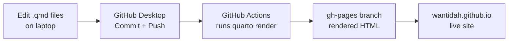
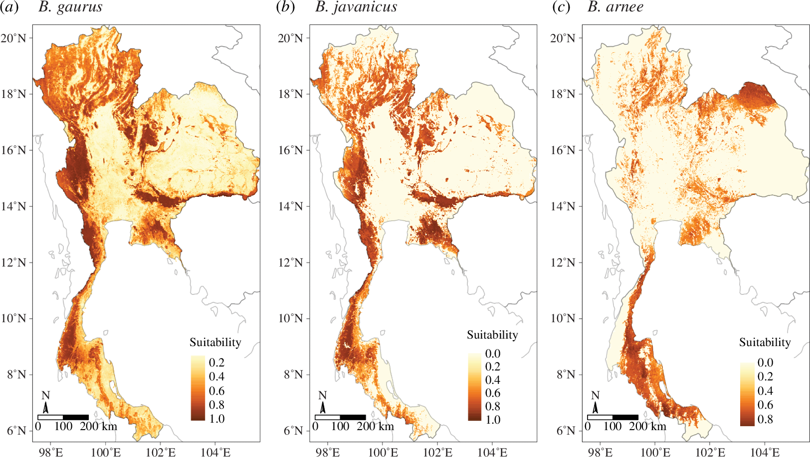

# Building and editing your Quarto research website

A tutorial for Wantida. Written for someone who is fluent in R, familiar with RStudio and RMarkdown, and new to web development.

This document has two halves. The **first half** is a map — how everything fits together and what the daily workflow looks like. The **second half** is a reference — every file in the project, every common edit, and every failure mode we hit while building it.

You can read it top to bottom the first time, then come back to specific sections as you need them. It lives in your repo at `TUTORIAL.md`, so GitHub will render it when you click the file.

---

## Table of contents

1. [How the site works — the big picture](#1-how-the-site-works--the-big-picture)
2. [Your file structure](#2-your-file-structure)
3. [The daily workflow (edit → live)](#3-the-daily-workflow-edit--live)
4. [Building a new site from scratch](#4-building-a-new-site-from-scratch)
5. [File-by-file reference](#5-file-by-file-reference)
6. [Editing recipes](#6-editing-recipes)
7. [Publishing, privacy, and cost](#7-publishing-privacy-and-cost)
8. [Troubleshooting](#8-troubleshooting)
9. [Sending an offline copy to a friend](#9-sending-an-offline-copy-to-a-friend)

---

## 1. How the site works — the big picture

There are four moving parts. Learn these four and the rest of the tutorial will make sense.

- **You** edit `.qmd` files on your laptop. `.qmd` is Quarto's file format — it is Markdown (plain text with simple formatting) with a YAML front-matter block, exactly like RMarkdown.
- **Quarto** is a renderer. It reads your `.qmd` files and produces HTML web pages, plus CSS and JavaScript, in a folder called `_site/`.
- **GitHub** stores your source files (one copy) and the rendered HTML (another copy on a special branch called `gh-pages`).
- **GitHub Pages** is a free GitHub service that serves the files on `gh-pages` at a public URL: `https://wantidah.github.io`.

The part that ties everything together is **GitHub Actions** — a robot that lives on GitHub. Every time you push a change, the robot runs Quarto for you in the cloud, pushes the rendered site to `gh-pages`, and GitHub Pages picks it up. You never have to render locally.

Here is that whole loop as a diagram:



Mental model if you know R: `.qmd` is to this site what `.Rmd` is to a bookdown or blogdown site. Quarto is a more modern, language-agnostic replacement for `rmarkdown::render()`. And GitHub Actions is the equivalent of telling a server "every time I commit, re-knit and re-deploy."

---

## 2. Your file structure

Here is everything in your repo, grouped by what it's for.

```
wantidah-website/
│
├── _quarto.yml                 # Site config: navbar, footer, theme
├── theme.scss                  # Colors, fonts, overall styling
├── styles.css                  # Small CSS tweaks on top of theme.scss
│
├── index.qmd                   # Home page
├── about.qmd                   # Bio, background, CV link
├── research.qmd                # Research themes with figures
├── publications.qmd            # Publication list
├── blog.qmd                    # Blog landing page
├── contact.qmd                 # Contact info
│
├── posts/                      # Blog posts
│   ├── _metadata.yml           # Defaults applied to every post
│   └── welcome/                # One folder per post
│       ├── index.qmd
│       └── thumbnail.jpg
│
├── images/                     # Photos, figures, icons
│   ├── profile.jpeg
│   ├── favicon.png
│   └── research/…              # Research-page SVGs + PNGs
│
├── files/                      # Downloadable files (e.g. CV PDF)
│   └── wantida-cv.pdf
│
├── .github/
│   └── workflows/
│       └── publish.yml         # GitHub Actions: auto-render + deploy
│
├── build-offline.sh            # One-command offline zip
├── README.md                   # Repo readme (shown on GitHub)
├── SETUP_GUIDE.html            # Step-by-step GitHub Pages setup
└── TUTORIAL.md                 # ← this document
```

**Categories, in one sentence each:**

- **Config files** (`_quarto.yml`, `theme.scss`, `styles.css`) tell Quarto how the whole site looks.
- **Page files** (`index.qmd`, `about.qmd`, …) are the actual pages you see in the navbar.
- **`posts/`** is where blog posts live — one folder per post.
- **`images/`** and **`files/`** are your static assets.
- **`.github/workflows/publish.yml`** is the automation.
- The other `.md` and `.html` files are documentation for you (or anyone reading your repo).

---

## 3. The daily workflow (edit → live)

Once everything is set up, updating your site is four clicks and a wait.

1. **Edit.** Open any `.qmd` file in your favourite editor (RStudio works great). Save.
2. **(Optional) Preview locally.** Open Terminal, `cd /Users/whorpien/wantidah-website`, run `quarto preview`. It opens a browser tab that live-reloads as you save. `Ctrl+C` in Terminal to stop.
3. **Commit + push in GitHub Desktop.**
   - Write a short summary at the bottom-left (e.g. *"Update about page"*).
   - Click **Commit to main**.
   - Click **Push origin** at the top.
4. **Wait 1–2 minutes.** GitHub Actions runs the render for you.
5. **Hard-refresh the live site** (`Cmd+Shift+R` on Mac) at [wantidah.github.io](https://wantidah.github.io).

That's it. You never need to run `quarto render` or `quarto publish` locally — the robot does it.

If something looks broken, first stop: [github.com/Wantidah/wantidah.github.io/actions](https://github.com/Wantidah/wantidah.github.io/actions). A red ✗ on the most recent "Publish site" run means the render broke. Click in and expand the failing step to see the error.

---

## 4. Building a new site from scratch

This section is for building a fresh website from an empty folder. If you're editing your existing site, skip to [§5](#5-file-by-file-reference). If you ever want to help a colleague build their own site, this is the path.

### 4.1 Install the tools

- **Quarto** — <https://quarto.org/docs/get-started/>. Accept defaults. Check: `quarto --version` in Terminal shows a version number.
- **GitHub Desktop** — <https://desktop.github.com>. Sign in with your GitHub account.
- **A text editor** — RStudio works. VS Code is also excellent.

### 4.2 Create a GitHub repo

On GitHub.com, click the `+` icon → **New repository**.

- Name: **`your-username.github.io`** (the name must match your GitHub username exactly for the site to be served at `your-username.github.io`).
- **Public**. (Pages only serves public repos for free — see [§7](#7-publishing-privacy-and-cost).)
- Initialize with a README: **yes**.
- Click **Create repository**.

### 4.3 Clone it with GitHub Desktop

File → **Clone repository** → pick `your-username/your-username.github.io` → choose a local folder (for example `/Users/whorpien/wantidah-website`) → **Clone**.

You now have an empty folder on your computer that is already connected to GitHub.

### 4.4 Create the starter files

Inside the cloned folder, create each file from [§5](#5-file-by-file-reference) below. Copy the full contents exactly. You'll need at minimum:

1. `_quarto.yml`
2. `theme.scss`
3. `styles.css`
4. `index.qmd`
5. `about.qmd`
6. One or two more pages (research, publications, etc.)
7. `images/profile.jpeg` (any 800×800 photo)
8. `.github/workflows/publish.yml`

### 4.5 Preview it

```bash
cd /Users/whorpien/your-site-folder
quarto preview
```

Browser opens. Click through the pages. If anything looks wrong, read the error in Terminal — it almost always points to a typo in the YAML front matter of a `.qmd` file.

### 4.6 First commit + push

In GitHub Desktop you'll see all the files in the **Changes** tab. Summary: `Initial site`. Click **Commit to main** → **Push origin**.

### 4.7 Turn on GitHub Pages

Go to [github.com/your-username/your-username.github.io/settings/pages](https://github.com/Wantidah/wantidah.github.io/settings/pages).

- **Source**: *Deploy from a branch*
- **Branch**: `gh-pages` / `(root)` — it may not exist yet, we'll create it in the next step.

If `gh-pages` doesn't appear yet, that's fine — it'll be created the first time the GitHub Actions workflow runs.

### 4.8 Wait for the Action to finish

Go to [github.com/your-username/your-username.github.io/actions](https://github.com/Wantidah/wantidah.github.io/actions). Click the most recent "Publish site" run. When it turns green ✓, refresh the Pages settings — `gh-pages` should now be selectable. Pick it and save.

~1 minute later, your site is live at `https://your-username.github.io`.

---

## 5. File-by-file reference

This section embeds the full contents of every file so the tutorial is self-contained. You could rebuild the whole site by copying each block into its named file.

### 5.1 `_quarto.yml` — site configuration

This is the master config. It controls the site title, URL, navbar items, footer, theme files, and rendering options.

```yaml
project:
  type: website
  output-dir: _site
  resources:
    - "files/**"
    - "images/**"

website:
  title: ""                 # no brand text in the top-left navbar
  description: "Wantida Horpiencharoen — veterinary epidemiologist, wildlife disease ecologist, One Health researcher"
  site-url: "https://wantidah.github.io"
  repo-url: "https://github.com/Wantidah/wantidah.github.io"
  favicon: images/favicon.png

  navbar:
    background: light
    collapse-below: xxl        # always show the hamburger (three-line) menu top-left
    logo: ""
    search: true
    left:
      - href: index.qmd
        text: Home
      - href: about.qmd
        text: About
      - href: research.qmd
        text: Research
      - href: publications.qmd
        text: Publications
      - href: blog.qmd
        text: Blog
      - href: contact.qmd
        text: Contact

  page-footer:
    border: true
    left: "© 2026 Wantida Horpiencharoen"
    center:
      - icon: envelope
        href: mailto:wantidah@gmail.com
        aria-label: Email
      - icon: github
        href: https://github.com/Wantidah
        aria-label: GitHub
      - icon: mortarboard
        href: https://scholar.google.com/citations?user=4GTDIhMAAAAJ&hl=en
        aria-label: Google Scholar
      - icon: person-badge
        href: https://orcid.org/0000-0002-3526-9136
        aria-label: ORCID
    right: "Built with [Quarto](https://quarto.org)"

format:
  html:
    theme:
      light: [cosmo, theme.scss]
    css: styles.css
    toc: true
    toc-location: right
    anchor-sections: true
    smooth-scroll: true
    link-external-newwindow: true
    code-copy: true

execute:
  freeze: auto
```

**Key things to know:**

- `project.type: website` tells Quarto this is a multi-page site (not a book or a single document).
- `output-dir: _site` — rendered HTML goes into `_site/`. You never open this folder directly; it's a build artefact, like `.Rproj.user/` in RStudio.
- `collapse-below: xxl` forces the top nav links into the three-line hamburger menu on every screen size.
- `left:` — the order of items in `left:` is the left-to-right order in the nav menu. Reorder by swapping lines.
- `format.html.theme: [cosmo, theme.scss]` — start from the Bootstrap "cosmo" theme and overlay my `theme.scss` on top. This is how the warm earth-tone palette works.
- `execute.freeze: auto` — if a `.qmd` file contains R or Python code, Quarto only re-runs it when that file changes, not on every render. Speeds up builds. If you don't have computed chunks, it doesn't matter.

### 5.2 `theme.scss` — palette + typography

SCSS is a dialect of CSS that supports variables and nesting. Quarto uses SCSS files to override Bootstrap theme variables before compiling to CSS. This is where 90 % of the site's look-and-feel lives.

```scss
/*-- scss:defaults --*/

// Warm earth-tone palette inspired by wildlife/forest imagery
$sage:       #7a8f6b;
$moss:       #4a5d3a;
$sand:       #e9e2d3;
$clay:       #b8654a;
$cream:      #faf7f1;
$ink:        #2d2a26;
$ink-soft:   #5a534a;
$rule:       #d8cfbd;

// Bootstrap variable overrides
$primary:         $sage !default;
$secondary:       $clay !default;
$body-bg:         $cream !default;
$body-color:      $ink !default;
$link-color:      $moss !default;
$link-hover-color: $clay !default;

// Typography — Aptos (with graceful fallbacks), slightly larger body
$aptos-stack:       "Aptos", "Aptos Display", "Segoe UI", "Helvetica Neue", "Arial", sans-serif !default;
$aptos-serif-stack: "Aptos Serif", "Source Serif Pro", "Georgia", "Times New Roman", serif !default;

$font-family-sans-serif: $aptos-stack !default;
$font-family-serif:      $aptos-serif-stack !default;
$font-family-base:       $aptos-stack !default;
$headings-font-family:   $aptos-stack !default;

$font-size-base:         1.125rem !default;   // was 1rem — bumps body text
$h1-font-size:           2.35rem !default;
$h2-font-size:           1.65rem !default;
$h3-font-size:           1.30rem !default;
$h4-font-size:           1.15rem !default;
$headings-font-weight:   600 !default;
$headings-color:         $moss !default;

// Navbar — slimmer band (reduced height, not width)
$navbar-padding-y:       0.35rem !default;
$nav-link-padding-y:     0.35rem !default;
$navbar-brand-padding-y: 0.25rem !default;
$navbar-brand-font-size: 1rem !default;

$navbar-bg:  $cream !default;
$navbar-fg:  $ink !default;
$navbar-hl:  $clay !default;

$footer-bg:  $sand !default;
$footer-fg:  $ink-soft !default;

$code-bg:    #f3efe6 !default;
$code-color: $moss !default;

/*-- scss:rules --*/

// Body font + small rendering tweaks
body {
  font-family: $aptos-stack;
  line-height: 1.7;
  -webkit-font-smoothing: antialiased;
}

// ... (rules continue; see the actual file in the repo)
```

**Palette cheat sheet** — if you ever want to redesign:

| Variable | Value | Meaning |
|----|----|----|
| `$sage` | `#7a8f6b` | Primary accent (link, button fill) |
| `$moss` | `#4a5d3a` | Headings + strong text |
| `$sand` | `#e9e2d3` | Soft backgrounds (footer, headers) |
| `$clay` | `#b8654a` | Hover / highlight |
| `$cream` | `#faf7f1` | Page background |
| `$ink` / `$ink-soft` | `#2d2a26` / `#5a534a` | Body text |
| `$rule` | `#d8cfbd` | Thin dividers |

To recolour the site, change these eight variables at the top of the file. That's the whole job.

### 5.3 `styles.css` — small tweaks

CSS file for quick overrides that don't need SCSS variables. Edit this for one-off rules; edit `theme.scss` for palette/typography shifts.

```css
/* styles.css — small tweaks on top of theme.scss. */

/* Always collapse the top nav into the three-line hamburger menu,
   no matter how wide the screen is. */
.navbar .navbar-toggler { display: inline-block !important; }
.navbar .navbar-collapse {
  display: none !important;
  flex-basis: 100%;
}
.navbar .navbar-collapse.show {
  display: block !important;
}

/* Landing-page breathing room */
.quarto-about-trestles,
.quarto-about-jolla { padding-top: 1.5rem; }

/* Home page hero: photo centered at top, name + subtitle centered,
   then normal left-aligned body text flows below. */
.home-hero {
  text-align: center;
  margin: 1rem 0 2rem 0;
}
.home-photo {
  width: 14em;
  height: 14em;
  object-fit: cover;
  border-radius: 50%;
  border: 4px solid #e9e2d3;
  box-shadow: 0 4px 18px rgba(0, 0, 0, 0.08);
  display: block;
  margin: 0 auto 1.2rem auto;
}
.home-name {
  font-size: 2.35rem;
  font-weight: 600;
  color: #4a5d3a;
  margin: 0.2rem 0 0.4rem 0;
  border-bottom: none;
}
.home-subtitle {
  color: #5a534a;
  font-size: 1.05rem;
  margin: 0;
}

/* Longer lines look tidier but not cramped at the larger base size */
main p,
main li { max-width: 68ch; }

/* Figures inside posts and research pages */
main figure img,
main p > img {
  border-radius: 6px;
  box-shadow: 0 2px 10px rgba(0, 0, 0, 0.06);
  max-width: 100%;
  height: auto;
}

/* Icon-only "find me" row on the home page — quiet, centered */
.find-me-icons {
  text-align: center;
  margin-top: 2rem;
  margin-bottom: 1.5rem;
  font-size: 2rem;
  line-height: 1;
}
.find-me-icons a {
  color: #7a8f6b;
  margin: 0 0.9rem;
  display: inline-block;
  border-bottom: none !important;
  text-decoration: none;
  transition: color 0.15s ease, transform 0.15s ease;
}
.find-me-icons a:hover {
  color: #b8654a;
  border-bottom: none !important;
  transform: translateY(-2px);
}
```

### 5.4 `index.qmd` — home page

The home page is a plain Quarto document. The `.home-hero` block uses the CSS from §5.3 to center the photo and name at the top, then the rest of the page flows as left-aligned prose.

```qmd
---
pagetitle: "Wantida Horpiencharoen"
toc: false
page-layout: article
---

```{=html}
<div class="home-hero">
  
  <h1 class="home-name">Wantida Horpiencharoen</h1>
  <p class="home-subtitle">Veterinary epidemiologist · Wildlife disease ecologist · One Health researcher</p>
</div>
```

Hi — I'm **Wow**, a postdoctoral researcher at **Penn State** ...

(rest of the body text)

::: {.callout-tip appearance="minimal"}
## What you'll find here
- My [research](research.qmd) on wildlife disease, spillover, and spatial epidemiology
- A list of my [publications](publications.qmd)
- A [blog](blog.qmd) with short pieces on wildlife conservation and One Health
- A bit more [about me](about.qmd) and how to get in touch
:::

---

```{=html}
<div class="find-me-icons">
  <a href="mailto:wantidah@gmail.com"><i class="bi bi-envelope"></i></a>
  <a href="https://github.com/Wantidah"><i class="bi bi-github"></i></a>
  …
</div>
```
```

**Patterns to notice:**

- YAML front matter is the bit between `---` at the top. `pagetitle` sets the browser tab title; `toc: false` hides the right-hand table of contents on the home page; `page-layout: article` picks a standard single-column layout.
- `` ```{=html} `` is a raw-HTML block — Quarto passes the contents through untouched. Use these when you need custom HTML (icons, styled divs) that Markdown can't express.
- `::: {.callout-tip}` … `:::` is Quarto syntax for a callout box (tip / note / warning / important / caution).

### 5.5 `about.qmd` — bio page

A longer Markdown page with `## Section headers`. Key pieces:

```qmd
---
title: "About"
image: images/profile.jpeg
toc: true
---

{fig-align="center" fig-alt="..."}

## Hi, I'm Wantida (Wow)

(paragraph text)

## Research interests

- **One Health thinking** — ...
- **Wildlife conservation** — ...
- **Disease ecology** — ...
- **Open, reproducible science** — ...

## Background

- **Postdoctoral Researcher** — Penn State University ...
- **PhD, Veterinary Epidemiology** — Massey University ...
- ...

## Tools I use

R · QGIS · stochastic compartmental models (SI/SEI/SIRS/SEIRS) ·
species distribution / habitat suitability modelling · GitHub for
reproducible workflows.

## CV

[Download CV (PDF)](files/wantida-cv.pdf){.btn .btn-outline-primary}
```

The `.btn .btn-outline-primary` on a link turns it into a button styled by your theme.

### 5.6 `research.qmd` — long-form research

Same pattern as about.qmd, but with figures, DOIs, and occasional raw-HTML blocks for SVG figures. For the mastitis + Western-Thailand maps, the SVGs are embedded via `<object>` so their external fonts (Patrick Hand) load:

```qmd
```{=html}
<figure class="mastitis-fig">
<object data="images/research/western-thailand-map.svg" type="image/svg+xml" aria-label="Western Thailand study area"></object>
<figcaption>Sampling locations of 43 smallholder dairy farms ... From Horpiencharoen <em>et al.</em> (2019), <em>Preventive Veterinary Medicine</em> <strong>164</strong>, 49–55 (<a href="https://doi.org/10.1016/j.prevetmed.2019.01.014">DOI</a>).</figcaption>
</figure>
```
```

For normal raster figures, Quarto's plain Markdown image syntax is enough:

```markdown
{fig-alt="Alt text for screen readers"}
```

### 5.7 `publications.qmd` — paper list

Plain Markdown list, grouped by year. Your name is bolded with `**Horpiencharoen, W.**`. Each paper ends with `[[DOI]](https://doi.org/...)`.

```qmd
---
title: "Publications"
toc: true
toc-depth: 2
---

### 2025

- **Horpiencharoen, W.**, Marshall, J. C., Muylaert, R. L., ...
  (2025). *Spatial risk of pathogen transmission from cattle to
  vulnerable and endangered wild bovids in Thailand.*
  **Conservation Science and Practice.**
  [[DOI]](https://doi.org/10.1111/csp2.70111)
```

A later upgrade (optional) is to keep your publications in a `references.bib` file (BibTeX) and let Quarto format them for you. Worth it if the list grows past ~30 papers.

### 5.8 `blog.qmd` — blog landing page

The `listing:` block tells Quarto to auto-scan the `posts/` folder and list every post it finds there. You never have to edit this file when you add a new post.

```qmd
---
title: "Blog"
subtitle: "Notes on wildlife conservation, disease ecology, and One Health"
image: images/mountain.jpeg
listing:
  contents: posts
  sort: "date desc"
  type: default
  categories: true
  fields: [date, title, description, categories, reading-time]
page-layout: full
title-block-banner: images/mountain.jpeg
title-block-banner-color: "#faf7f1"
toc: false
---

Short, plain-language posts about my research, things I read, and
thoughts from the field. ...
```

### 5.9 `posts/_metadata.yml` — shared defaults

Front-matter keys you set here apply to *every* post in `posts/` automatically. Saves repeating yourself.

```yaml
# Shared defaults applied to every post in /posts
freeze: true
title-block-banner: true
author: "Wantida"
comments: false
```

### 5.10 `posts/<slug>/index.qmd` — a blog post

One folder per post, named with a slug (e.g. `posts/welcome/` or `posts/2026-05-bats-and-ranches/`). Each folder has an `index.qmd` plus optional images.

```qmd
---
title: "Pangolins, pathogens, and the price of land-use change"
description: "Why Southeast Asia's wildlife trade and shifting landscapes keep putting people, livestock, and wild animals on the same map."
author: "Wantida"
date: "2026-04-19"
categories: [one-health, wildlife-trade, emerging-diseases]
image: thumbnail.jpg
draft: false
---

Welcome — thanks for stopping by. ...
```

- `date` controls ordering on the blog listing.
- `categories` produces the coloured category pills.
- `image: thumbnail.jpg` is the card image on the blog listing. Put a `thumbnail.jpg` in the same folder.
- `draft: true` hides the post from the listing — handy for work in progress.

### 5.11 `contact.qmd` — contact info

A plain page. Email, GitHub, Scholar, ORCID; paragraphs for "Collaborations" and "Mentoring". No special syntax.

### 5.12 `.github/workflows/publish.yml` — the auto-deploy

This is the robot. On every push to `main`, GitHub Actions:

1. Checks out your repo.
2. Installs Quarto.
3. Runs `quarto render` to produce `_site/`.
4. Pushes `_site/` to the `gh-pages` branch, which GitHub Pages serves.

```yaml
name: Publish site

on:
  push:
    branches: [main]
  workflow_dispatch:

jobs:
  build-deploy:
    runs-on: ubuntu-latest
    permissions:
      contents: write
    steps:
      - name: Check out repository
        uses: actions/checkout@v4

      - name: Set up Quarto
        uses: quarto-dev/quarto-actions/setup@v2

      - name: Render site
        run: quarto render

      - name: Deploy rendered site to gh-pages
        uses: peaceiris/actions-gh-pages@v4
        with:
          github_token: ${{ secrets.GITHUB_TOKEN }}
          publish_dir: ./_site
          publish_branch: gh-pages
          force_orphan: true
```

- `permissions.contents: write` — needed so the robot can push to `gh-pages`.
- `peaceiris/actions-gh-pages@v4` is a third-party action that knows how to wipe `gh-pages` and push fresh HTML there.
- `force_orphan: true` means `gh-pages` gets a clean new commit each time — no history buildup.

### 5.13 `build-offline.sh` — send the site to a friend

A helper Bash script that renders the site and zips it into one file. Use when you want someone to review the site without it being live on the internet.

```bash
#!/usr/bin/env bash
set -euo pipefail
ROOT="$(cd "$(dirname "${BASH_SOURCE[0]}")" && pwd)"
cd "$ROOT"

OUT_DIR="_site"
ZIP_NAME="wantidah-website-offline.zip"

echo "→ Rendering site with Quarto..."
quarto render

cat > "$OUT_DIR/OPEN-ME.txt" <<EOF
To view: double-click index.html (or open it in any browser).
Everything is local — no server or internet required.
EOF

echo "→ Zipping $OUT_DIR → $ZIP_NAME..."
rm -f "$ZIP_NAME"
zip -r -q -X "$ZIP_NAME" "$OUT_DIR"
echo "✓ Done. Send $ZIP_NAME to your friend."
```

Run it with `./build-offline.sh`. See [§9](#9-sending-an-offline-copy-to-a-friend).

### 5.14 `README.md` — the GitHub landing page

Displayed automatically when anyone opens the repo on GitHub. Keep it short:

```markdown
# wantidah.github.io

Source for Wantida's personal research website — built with
[Quarto](https://quarto.org) and published via GitHub Pages at
<https://wantidah.github.io>.

## Structure

...

## Edit / preview locally

    quarto preview

## Publish to GitHub Pages

Automatic: just commit + push to `main`. A GitHub Actions workflow
renders and deploys to the `gh-pages` branch. See `TUTORIAL.md`
for the full walkthrough.
```

---

## 6. Editing recipes

Day-to-day jobs, one mini-recipe each.

### 6.1 Change a heading

Open the `.qmd` file. Find the line starting with `##`. Edit the text after it. Save.

```markdown
## What I care about          ← before
## Research interests         ← after
```

Commit + push. ~2 min later, it's live.

### 6.2 Add a paragraph

Just add new text between existing paragraphs. One blank line between paragraphs is enough.

### 6.3 Add a new navbar page

Two steps:

1. Create the new page as a `.qmd` file at the project root, e.g. `teaching.qmd`:
    ```qmd
    ---
    title: "Teaching"
    toc: true
    ---

    I teach ...
    ```
2. Add the page to the navbar in `_quarto.yml`:
    ```yaml
    navbar:
      left:
        - href: index.qmd
          text: Home
        - href: about.qmd
          text: About
        - href: teaching.qmd           # ← new
          text: Teaching
        - href: research.qmd
          text: Research
        ...
    ```

### 6.4 Remove a navbar page

Delete its entry from `_quarto.yml`. You can keep the `.qmd` file around — it just won't appear in the menu.

### 6.5 Reorder navbar items

Swap the order of the entries under `navbar.left:` in `_quarto.yml`. Top of the list = leftmost in the menu.

### 6.6 Change the profile photo

Replace `images/profile.jpeg` with your new photo. Same filename, same folder. Commit + push. Done.

If you want to use a different filename, also update the reference in `index.qmd`:

```html
   <!-- change this -->
```

And in `about.qmd`'s YAML:
```yaml
image: images/profile.jpeg
```

### 6.7 Change the colour palette

Open `theme.scss`. Edit the top section:

```scss
$sage:       #7a8f6b;    // change the hex codes
$moss:       #4a5d3a;
$sand:       #e9e2d3;
$clay:       #b8654a;
$cream:      #faf7f1;
```

Use a tool like [coolors.co](https://coolors.co) to generate a new palette. Keep the *names* — the rest of the file references them — only change the values.

### 6.8 Add an image to a page

Put the image in `images/` (or a subfolder like `images/research/`). Reference it with Markdown image syntax:

```markdown
{fig-alt="Alt text for screen readers"}
```

The `fig-alt` is not optional for accessibility. Write one sentence describing what a sighted reader sees.

### 6.9 Add a new publication

Open `publications.qmd`. Find the right year heading. Add a new bullet at the top of that year (most-recent first):

```markdown
### 2025

- **Horpiencharoen, W.**, ... (2025). *Paper title in italics.*
  **Journal Name.** [[DOI]](https://doi.org/10.xxxx/xxxxx)
```

### 6.10 Add a new blog post

1. Copy `posts/welcome/` to a new folder with a slug name, e.g. `posts/2026-05-bats-and-ranches/`.
2. Open `index.qmd` in the new folder. Update the YAML:
    ```yaml
    ---
    title: "Bats and ranches: notes from the field"
    description: "What we saw in northern Thailand this May."
    date: "2026-05-02"
    categories: [wildlife, field-notes, one-health]
    image: thumbnail.jpg
    draft: false
    ---
    ```
3. Replace the body with your post.
4. Drop a `thumbnail.jpg` (800×600 or similar) in the same folder.
5. Commit + push.

If you want to work on it privately first, set `draft: true` — the post won't appear in the listing until you flip it to `false`.

### 6.11 Change the footer text

`_quarto.yml` → `website.page-footer.left` / `center` / `right`. Icons use Bootstrap Icons (see <https://icons.getbootstrap.com>).

### 6.12 Change the site URL / switch to a custom domain

1. Buy a domain (e.g. `wantida.science` from Namecheap / Cloudflare / Google Domains).
2. In your repo Settings → Pages → **Custom domain** box, enter the domain.
3. Your registrar needs a CNAME record pointing to `wantidah.github.io`. GitHub's Pages docs walk through this step-by-step.
4. Update `site-url:` in `_quarto.yml` to the new domain.

---

## 7. Publishing, privacy, and cost

### Three real scenarios

| You want | Repo visibility | GitHub plan | Cost |
|----|----|----|----|
| Site public, source public | Public | Free | $0 |
| Site offline while revising; source private | Private | Free | $0 (site goes offline) |
| Site public, source private | Private | Pro | $4 / month |

### What "private" actually means

- **Private repo, free plan** — only you (and explicit collaborators) can see the `.qmd` source. GitHub Pages *stops serving* the site while the repo is private. Anyone who had the URL gets a 404.
- **Private repo, Pro plan** — same, but GitHub Pages keeps serving the site.
- **Public repo** — anyone can see the `.qmd` source on GitHub, and anyone can read the live site. This is the norm for personal academic sites.

### How to flip visibility

`Settings → General → Danger Zone → Change repository visibility`. Confirm by typing the repo name.

### The practical advice

While you're revising content, your *draft* changes stay on your laptop until you `git push`. You can edit privately for weeks without making the repo private — nothing is public until you push. Only make the repo private if you specifically don't want the commit history / source visible.

---

## 8. Troubleshooting

### "The live site is showing my README instead of the Quarto site"

The `gh-pages` branch doesn't have rendered HTML yet (or has old content). Go to [Actions](https://github.com/Wantidah/wantidah.github.io/actions) — if the "Publish site" run is red, click in and read the failing step. If it's green, browser cache — hard-refresh (`Cmd+Shift+R`).

### "My Action run is red"

Click the failing step. Common causes:

- **YAML parse error** in a `.qmd` front matter (a stray colon or missing quote).
- **Image path broken** — Quarto can't find `images/foo.png`. Check the filename case exactly — GitHub is case-sensitive even though your Mac isn't.
- **Fenced code block not closed** — `` ``` `` without a matching `` ``` ``.

### "quarto preview works locally but Actions fails"

The Action uses `quarto render` (batch mode), not `quarto preview` (dev server). Some errors only show up in render — especially missing R or Python packages if you have computed chunks. Running `quarto render` locally replicates what Actions does.

### "I changed styles.css but nothing updated"

Browser cache. `Cmd+Shift+R`. If still nothing, you might have a syntax error in the CSS — open your browser's DevTools (`Cmd+Option+I` → *Console* tab).

### "My blog post isn't appearing"

- `draft: true` in its YAML — flip to `false`.
- Post is in the wrong folder — it must be under `posts/<anything>/index.qmd`, not `posts/<anything>.qmd`.
- `date` is in the future — posts with future dates are skipped.

### "GitHub Desktop says 'nothing to commit' but I edited a file"

You saved the file but didn't save *to the right location*. Make sure the folder open in your editor is the same one GitHub Desktop is pointed at. Also check `Repository → Show in Finder` to verify.

### "Someone with the URL sees a 404"

Either (a) the repo is private on the free plan — make it public, or upgrade to Pro; or (b) GitHub Pages is set to the wrong branch — check Settings → Pages → Source points at `gh-pages` / `(root)`.

---

## 9. Sending an offline copy to a friend

Sometimes you want a colleague to see the site without publishing it (reviewing a draft, a friend with no internet, etc). There is a helper script.

```bash
cd /Users/whorpien/wantidah-website
chmod +x build-offline.sh    # first time only
./build-offline.sh
```

Output: `wantidah-website-offline.zip` in the project folder. Your friend unzips it anywhere, double-clicks `index.html`, and the site opens in their browser. No internet, no server.

Manual alternative (same result, no script):

```bash
cd /Users/whorpien/wantidah-website
quarto render
cd _site && zip -r ../wantidah-website-offline.zip .
```

A handful of Google-hosted web fonts fall back to system fonts when offline — the layout is unchanged.

---

## A quick reminder of the whole workflow

Once everything is set up, **all you do** to update your site is:

1. Edit a `.qmd` file.
2. GitHub Desktop → **Commit to main** → **Push origin**.
3. Wait ~1–2 min.
4. Hard-refresh `wantidah.github.io`.

If it breaks, check the [Actions tab](https://github.com/Wantidah/wantidah.github.io/actions) for the red ✗ and come back to [§8](#8-troubleshooting).

That's the whole thing. Have fun — and if you want to add things later (a custom domain, a references.bib for auto-formatted publications, a GitHub profile README so visitors to your GitHub profile see a "Visit my website" link), those are all one-afternoon projects.

— Tutorial updated 2026-04-19.
