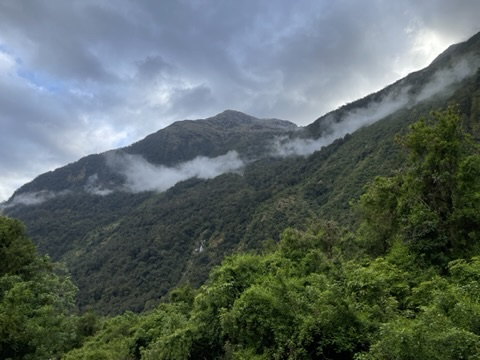

{fig-align="center" fig-alt="Mountains — one of the places I've been lucky to work and walk."}

## Hi, I'm Wantida (Wow)

I'm a veterinary epidemiologist and disease ecologist working at the
overlap of **veterinary medicine, wildlife health, and One Health**.
I try to keep one foot in the field — with animals, landscapes, and
communities — and one foot in the data.

Right now I'm a postdoctoral researcher at **Penn State (Department
of Ecosystem Science and Management)**, where I work on targeted
surveillance for **SARS-CoV-2 in white-tailed deer** across
Pennsylvania and eight other U.S. states, in collaboration with
USDA and USGS. My days involve R, GPS movement data, contact
networks, and many, many deer.

Before Penn State, my PhD at **Massey University (New Zealand)**
focused on *wild bovid habitat and infectious disease risk in
Thailand* — using habitat suitability models and disease-dynamic
simulations to map where threatened wild cattle species (gaur,
banteng, wild water buffalo) overlap with domestic livestock and
shared pathogens.

## What I care about

- **One Health thinking** — treating human, animal, and environmental
  health as one connected system.
- **Wildlife conservation** — especially threatened species and the
  landscapes they depend on.
- **Disease ecology** — understanding *where* and *why* pathogens
  emerge, not just *what* they are.
- **Open, reproducible science** — sharing code and data so other
  researchers (and future me) can build on the work.

## Background

- **Postdoctoral Researcher** — Penn State University, USA
  (April 2024 – present). *Targeted Surveillance for SARS-CoV-2 in
  White-tailed Deer.*
- **PhD, Veterinary Epidemiology** — Massey University, New Zealand
  (2020 – 2024). Dissertation: *Wild bovid habitat and infectious
  disease risk in Thailand.* Supervised by David T. S. Hayman, with
  co-supervisors Jonathan Marshall, Renata Muylaert, and Reju Sam
  John.
- **Field Researcher** — Golden Triangle Asian Elephant Foundation &
  Hunter College CUNY (2019 – 2020). Studying elephant behaviour and
  human–elephant conflict in Kanchanaburi, Thailand.
- **Research Assistant** — Kasetsart University (2018 – 2019).
  Dog-population surveillance and rabies control (CNVR).
- **Veterinary Clinician** — Livestock and Wildlife Hospital, Mahidol
  University (2012 – 2015). Clinical practice with livestock and
  wildlife, including rehabilitation of trafficked species.
- **MS, Veterinary Epidemiology** — Kasetsart University (2016 – 2018).
- **DVM (Doctor of Veterinary Medicine)** — Kasetsart University
  (2006 – 2012).

## Tools I use

R (`tidyverse`, `sf`, `amt`, `glmmTMB`, `survival`, `mgcv`) · QGIS ·
ArcGIS · stochastic compartmental models (SI/SEI/SIRS/SEIRS) ·
Bayesian inference · contact-network analysis · species distribution /
habitat suitability modelling (MaxEnt, GLM/GAM) · GitHub for
reproducible workflows.

## CV

[Download CV (PDF)](files/wantida-cv.pdf){.btn .btn-outline-primary}

## Languages

Thai (native) · English (fluent).

## Contact

The best way to reach me is by email —
[wantidah@gmail.com](mailto:wantidah@gmail.com). I'm also on
[GitHub](https://github.com/Wantidah).
