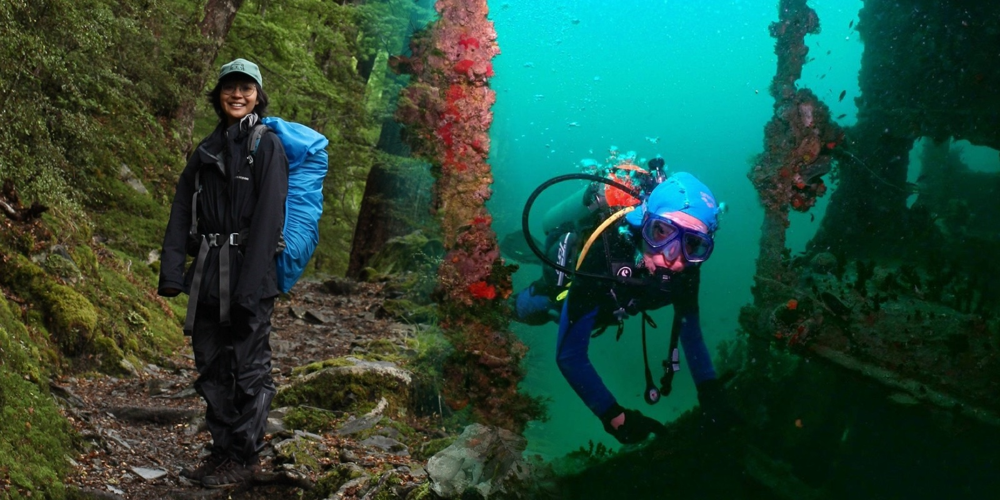

```{=html}
<div class="home-hero">
  
  <h1 class="home-name">Wantida Horpiencharoen</h1>
  <p class="home-subtitle">Veterinary epidemiologist · Wildlife disease ecologist · One Health researcher</p>
</div>
```

Hi — I'm **Wow**, a postdoctoral researcher at **Penn State** working on
SARS-CoV-2 surveillance in white-tailed deer. I'm a veterinarian
(DVM, Kasetsart) and disease ecologist (PhD, Massey University) whose
work sits at the **wildlife–livestock–human interface**.

My research combines GPS movement analysis, contact networks, species
distribution modelling, and stochastic compartmental models to
understand how pathogens circulate in wildlife — and what that means
for conservation and public health.

I care about **One Health thinking**, **open reproducible science**
in R, and fieldwork that stays close to the animals and communities
it's meant to serve.

::: {.callout-tip appearance="minimal"}
## What you'll find here
- My [research](research.qmd) on wildlife disease, spillover, and spatial epidemiology
- A list of my [publications](publications.qmd)
- A [blog](blog.qmd) with short pieces on wildlife conservation and One Health
- A bit more [about me](about.qmd) and how to get in touch
:::

---

```{=html}
<div class="find-me-icons">
  <a href="mailto:wantidah@gmail.com" aria-label="Email" title="Email"><i class="bi bi-envelope"></i></a>
  <a href="https://github.com/Wantidah" aria-label="GitHub" title="GitHub"><i class="bi bi-github"></i></a>
  <a href="https://scholar.google.com/citations?user=4GTDIhMAAAAJ&amp;hl=en" aria-label="Google Scholar" title="Google Scholar"><i class="bi bi-mortarboard"></i></a>
  <a href="https://orcid.org/0000-0002-3526-9136" aria-label="ORCID" title="ORCID"><i class="bi bi-person-badge"></i></a>
</div>
```
